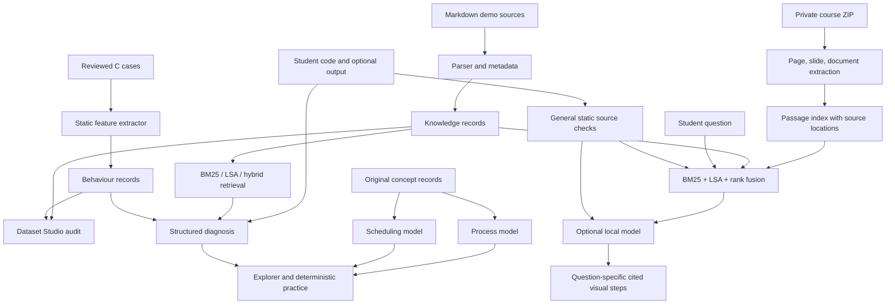

# Architecture

## Decision: keep evidence and model state separate

OS Lab Companion keeps three kinds of facts separate. **Expected** facts describe a teaching model or experiment requirement. **Inferred** facts come from static source analysis. **Observed** facts require a real run or a user-supplied output, labelled by its provenance. These are kept separate in the behaviour records and code review response. A deterministic teaching simulation never becomes an observed student trace.

The current study path adds a fourth category: **retrieved source text** from the private course archive or clearly labeled original project lab notes. A local model can explain those passages and propose a visual sequence, but its output is generated text, not an observed fact. The original passages remain visible below every answer.

## Backend modules

- `oslab/knowledge.py` parses sectioned Markdown, deduplicates records and implements BM25, LSA and reciprocal rank fusion. The existing retrieval benchmark is held as a regression baseline.
- `oslab/course.py` imports private PDF/PPTX/DOCX text and keeps file hashes and page/slide locations. Its local search index combines BM25, LSA and rank fusion over course passages plus separately labeled original project lab notes.
- A separate private `textbook_resources_index.json` is merged at startup. It contains a supplied 8th-edition *Operating System Concepts* PDF and Wiley 10th-edition companion slides. The search source selector can restrict results to course notes, textbook resources, or both; each reference hit retains its edition and material type.
- `oslab/code_review.py` extracts cautious OS API source clues with line numbers and builds a checked walkthrough for the pipe/EOF-loop pattern. `oslab/local_model.py` calls a localhost Ollama or llama.cpp server with a constrained JSON schema, validates source IDs and coverage, and returns an explanation and source-linked visual steps when evidence is sufficient.
- `oslab/behaviour.py` builds reviewed fork/wait case records, extracts selected source signals and normalizes supported syscall trace names. Its regexes cover demonstration patterns, not arbitrary C control flow.
- `oslab/studio.py` makes raw input, heading locations, source hashes, record metadata, source diffs and quality warnings inspectable. A 16-character dataset fingerprint hashes public source documents, reviewed case source and concept records. It is a change detector, not a release number.
- `oslab/concepts.py` validates unique concept IDs and prerequisites. Concept records contain original claims, misconceptions, linked demo records where available and URLs for further reading.
- `oslab/process_model.py` defines explicit events and a reducer for a small fork/wait teaching scenario. Each frame has an event, title, concept ID and state snapshot. Prediction grading uses this same model.
- `oslab/scheduling.py` independently models seven single-CPU policies: FCFS, nonpreemptive SJF, SRTF, nonpreemptive Priority, Round Robin, fixed two-level Multilevel Queue, and two-level Multilevel Feedback Queue. It presents the same event/frame shape but keeps scheduling-specific state in its own module.
- `oslab/diagnose.py` combines experiment context, static signals, known failure matches and retrieved sections into a structured result before deterministic explanation text. A fork/wait diagnosis links to the relevant visual scenario.
- `oslab/__main__.py` serves the localhost UI and read-only dataset/model endpoints; it also handles validated analysis, practice and scheduling requests.

## Process-model scope

The parent and child state model supports a parent selected first or child selected first after `fork`. With `waitpid`, the parent's completion output follows the child's exit in both scenarios. Without it, the two selected schedules demonstrate both output orders. The model tracks whether the child has been reaped. It omits signals, multiple children, precise Linux scheduling, kernel internals, and reparenting details. Its snapshots are teaching states, not actual runtime observations.

## Scheduling-model scope

Input contains one to eight processes with integer arrivals and CPU bursts. FCFS and RR use arrival/input order. SJF selects the shortest ready total burst at dispatch; SRTF can interrupt a running job when a strictly shorter remaining job is ready. Priority chooses the lowest number at dispatch and is nonpreemptive. Fixed Multilevel Queue puts each process into a foreground RR or background FCFS queue; foreground work can interrupt background work. Multilevel Feedback Queue starts every job in the high RR queue, demotes it after one full quantum, and runs low jobs FCFS unless a new high job arrives. The engine emits arrival, dispatch, CPU tick, preemption, demotion, completion and idle events. Waiting, turnaround and response metrics are derived from completion and first-start times. It omits I/O, context-switch overhead, aging, boosting, and multiprocessor effects. The UI renders snapshots and reveals the Gantt timeline progressively.

## Security boundary

No HTTP request can reach a compile or run path. The trusted Linux collector is a separate explicit command limited to checked-in examples. It lacks a container boundary and must never be repurposed to execute pasted student code. The app and local model bind to `127.0.0.1`. Private documents and the generated course index are stored in gitignored `data/private/`; the web app reads that index at startup.
